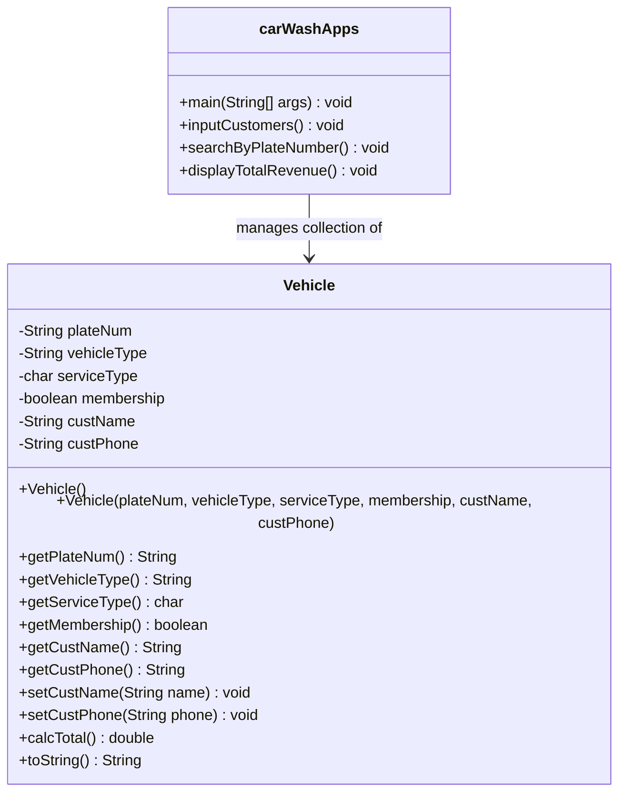

# 🚗 Fresh Car Wash Management System — Point of Sale & Customer Operations

[](https://www.oracle.com/java/)
[](https://en.wikipedia.org/wiki/C_(programming_language))
[]()
[]()
[](LICENSE)

> **Fresh Car Wash Management System** is a business operations and customer transaction platform designed for automotive service centers. Developed to replace manual physical logbooks, it automates vehicle queue intake, service tier pricing, loyalty membership discounts, customer profile queries by license plate number, and end-of-day revenue calculations in both **Java (Object-Oriented)** and **C**.

---

## 📌 Problem Background & Solution

Operating out of Taman Maluri, Kuala Lumpur, **Fresh Car Wash** experienced significant business growth across multiple vehicle service tiers. However, relying on physical handwritten record logbooks introduced critical operational challenges:
* **Logbook Bottlenecks:** Staff had to manually flip through thick paper archives to find returning customer history or verify warranty claims.
* **Calculation Inconsistencies:** Manual computation of tiered rates combined with membership discounts frequently introduced mathematical errors during peak queue hours.
* **Storage Footprint:** Storing years of physical service logbooks consumed excessive physical office space.

**Fresh Car Wash System** solves these challenges by digitalizing the entire service workflow:
* **Digital Queue Entry:** Immediate capture of license plate, customer name, contact number, vehicle classification, and chosen wash package.
* **Dynamic Tiered Pricing:** Automated fee calculation based on package type (Standard, Premium, Vacuum, Full Cleaning) and vehicle size adjustments.
* **Membership Discount Engine:** Automatic discount computation for registered loyalty members.
* **Fast License Plate Lookup:** Instant array/object traversal to display historical customer service orders or update contact information.

---

## 🧼 Service Tiers & Pricing Structure

| Code | Service Tier | Price (MYR) | Inclusions |
|---|---|---|---|
| **`S`** | **Standard Wash** | RM 10.00 | Exterior pressure rinse, active foam wash, tire dressing |
| **`P`** | **Premium Wash** | RM 13.70 | Standard wash + hydrophobic wax coating, rim degreasing |
| **`V`** | **Vacuum Only** | RM 5.80 | Interior cabin vacuum, floor mat cleaning, boot vacuuming |
| **`F`** | **Full Cleaning** | RM 14.50 | Complete exterior premium wash, deep interior vacuum & dashboard sanitization |

### Supported Vehicle Classifications:
* `Sedan` | `MPV` | `SUV` | `Hatchback` | `Sport` | `4X4`

---

## 🏗️ System Architecture & Class Model



---

## 📂 Project Directory Structure

```text
Fresh_Carwash/
├── carWashApps.java                # Java application entry point & operational menu
├── Vehicle.java                    # Object-Oriented Vehicle entity & pricing methods
├── FRESH CARWASH SYSTEM (C).c      # Procedural C implementation
├── README.md                       # Comprehensive system documentation
└── .gitignore                      # Ignores compiled binaries and editor artifacts
```

---

## 🛠️ Compilation & Execution Guide

### Running the Java Implementation (Recommended)
1. Ensure Java (JDK 8 or newer) is installed:
   ```bash
   javac -version
   ```
2. Compile both Java classes:
   ```bash
   javac Vehicle.java carWashApps.java
   ```
3. Run the application:
   ```bash
   java carWashApps
   ```

### Running the C Implementation
1. Compile with GCC:
   ```bash
   gcc "FRESH CARWASH SYSTEM (C).c" -o FreshCarwash.exe
   ```
2. Run the executable:
   ```bash
   ./FreshCarwash.exe
   ```

---

## 👨‍💻 Authors & Academic Attribution
* **Development Team:**
  * **Muhammad Akhmal bin Mohamad Hussin** (2022870756) — [@akhmal02](https://github.com/akhmal02)
  * Nik Yusuf (2022606254)
  * Muhammad Syafiq (2022831866)
  * Rizalliff Nabil (2022451146)
* **Institution:** Universiti Teknologi MARA (UiTM)
* **Faculty:** College of Computing, Informatics and Mathematics
* **Course:** Object-Oriented Programming (CSC248 / CSC264)
